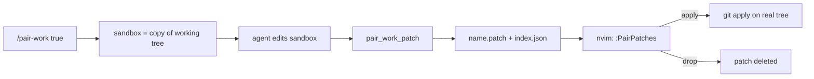

# Milou 🐶 (omp + nvim)

Three [omp](https://github.com/can1357/oh-my-pi) extensions, auto-loaded from `~/.omp/agent/extensions/`.

| File | What it does |
| --- | --- |
| [`pair-work.ts`](pair-work.ts) | Code review outside the harness: the agent writes patches, you review and apply them in Neovim. Git is the backend. |
| [`notes-mentions.ts`](notes-mentions.ts) | `@notes:<query>` autocomplete for notes in the Obsidian vault. |
| [`sym-mentions.ts`](sym-mentions.ts) | `@sym:<query>` autocomplete for code symbols in the current codebase. |

## Pair work mode

The agent can't touch your working tree. It edits a throwaway copy of the repo and hands you a `git apply`-able patch. You review the patch in Neovim and apply it yourself.



### Commands

```
/pair-work true      enter the mode (aliases: on, 1, yes)
/pair-work false     leave it; deletes the sandbox, restores the full tool set (off, 0, no)
/pair-work status    (also: no argument)
```

The mode is stored in the session. It comes back on resume, `/new` and startup. The status bar shows `pair-work: patch only`.

### How it works

- **Sandbox.** Built from the exact working tree: tracked changes plus untracked, non-ignored files. It goes through a temporary copy of the index (`git add -A` + `write-tree` + `git archive`), so your real index, refs and files are never touched. The sandbox is its own git repo with a `pair-work baseline` commit. It lives in `~/.omp/agent/pair-work/sandboxes/<hash>`, one per (repo, session).
- **Rebuild.** Entering the mode always builds a fresh sandbox. Afterwards it is kept as long as your working tree is unchanged, so revisions keep their edits. If the tree changed (for example you applied a patch), it is rebuilt from the new tree and the agent is told that unapplied sandbox edits are gone.
- **Gate.** A `tool_call` hook denies everything except an allowlist. The same tools are removed from the model's active tool set. The gate is shared with subagents.

  | Tool | Allowed |
  | --- | --- |
  | `read`, `grep`, `glob`, `find`, `ast_grep`, `web_search`, `ask`, `todo`, `wait`, `task`, `recall`, `reflect`, `yield`, `think` | always |
  | `edit`, `write`, `ast_edit` | only on absolute paths inside the sandbox (symlinks resolved, `..` refused, globs checked by their literal prefix) |
  | `lsp` | read actions only (`diagnostics`, `definition`, `references`, `hover`, `symbols`, `type_definition`, `implementation`, `status`, `capabilities`) |
  | `bash` | plain read-only `git` (`status diff log show blame ls-files ls-tree rev-parse rev-list merge-base name-rev describe shortlog cat-file grep`). No quotes, pipes, redirects or chaining. |
  | everything else (MCP, `eval`, ...) | denied |

- **Patch.** The `pair_work_patch(name, summary)` tool commits nothing. It diffs the sandbox against its baseline, writes `<name>.patch` and runs `git apply --check` against your real tree. It then registers the patch in `index.json`. Calling it again with the same name replaces the patch. Patches are cumulative against the real working tree.
- **System prompt.** While the mode is on, a `<pair-work-mode>` block is appended to the system prompt. It gives the sandbox path, the path mapping and the rules.

> This is a guardrail against an agent doing the wrong thing, not a security sandbox. The edit-target parser is best effort and `bash` is limited by a token allowlist, not by the OS.

### Where things are written

| Path | Content |
| --- | --- |
| `~/.omp/agent/pair-work/sandboxes/<hash>` | sandbox repo (`<hash>.tree` records the tree it was built from) |
| `~/.omp/agent/pair-work/patches/<repo basename>/<name>.patch` | patches |
| `~/.omp/agent/pair-work/patches/<repo basename>/index.json` | `{ version, patches: [{ name, file, root, summary, createdAt }] }` |

Set `PAIR_WORK_PATCH_DIR` to move the `patches/` root. The extension and Neovim must see the same value.

### Neovim side

Review lives in [`~/.config/nvim/lua/config/pairwork.lua`](../../../.config/nvim/lua/config/pairwork.lua). It is not part of this directory. It reads `index.json` for the repo of the current working directory.

| Command | Action |
| --- | --- |
| `:PairPatches` / `<leader>gp` | Telescope list (state, name, age, summary) with patch preview |
| `:PairPatchReview [name]` | Diffview: working tree vs working tree + patch |
| `:PairPatchQf [name]` | quickfix list, one entry per hunk |
| `:PairPatchApply [name]` | `git apply` after confirmation. The patch moves to `applied/`. |
| `:PairPatchDrop [name]` | delete the patch and its index entry after confirmation |

Inside the picker: `<CR>` review in Diffview, `<C-l>` quickfix hunks, `<C-o>` open the `.patch`, `<C-a>` apply, `<C-d>` drop.

`[name]` defaults to the newest patch. Patch states are `pending` (applies to the tree), `applied` (already in the tree) and `stale` (no longer applies). Review never touches your index, refs or files: it builds two dangling commits in a temporary index and diffs them.

Neovim polls the index every 3 s. It notifies on a new patch and exposes `require("config.pairwork").statusline()` for lualine (`patches: N`).

## Notes completion

Reference notes from the vault in an omp prompt.

Type `@notes:` followed by a query. Accepting a suggestion inserts the real, quoted, absolute path:

```
@notes:proj   →   @"/Users/me/notes/TURN DDOS/Project.md"
```

omp's built-in `@file` expansion then inlines the note on submit. The literal text `@notes:proj` would not be read, which is why the completion rewrites it.

- Candidates: every `.md` under the namespace root, except dot-directories (`.git`, `.obsidian`, `.trash`, ...).
- Ranking: exact name, name prefix, name substring, path substring, then subsequence. Up to 50 results. An empty query lists everything.
- The file index is cached for 3 s.
- The trigger is `@<namespace>:<query>` at a token boundary. A namespace maps to a directory in `NAMESPACES` at the top of [`notes-mentions.ts`](notes-mentions.ts). It ships with `notes` → `~/notes`. Add vaults there.

## Symbol mentions

Reference code symbols from the current codebase in an omp prompt.

Type `@sym:` followed by a query. Accepting a suggestion inserts the name plus a `path:line` selector, which is the form the agent's `read` tool takes:

```
@sym:MyFunc   →   `MyFunction` (src/foo.ts:42)
```

When the ctags parser reports an end line it inserts `path:start-end`. The TS/JS parser doesn't. It does not insert an `@file` mention, because that would inline the whole file and mentions don't support line ranges.

- Index: universal-ctags over the session cwd, using `rg --files` (gitignore-aware) when available and a recursive walk otherwise (skips `node_modules`, `.git`, `dist`, `build`, `target`, `vendor`, `.venv`, `__pycache__`).
- Skipped: locals, parameters, labels, headers, files, modules, and anything declared inside a function or method.
- YAML: top-level keys (indent ≤ 4 spaces, unquoted) are indexed as `key`.
- Ranking: exact name, name prefix, name substring, scope-qualified substring, then subsequence. Up to 50 results.
- The index is cached for 60 s with stale-while-revalidate: a stale index is served immediately while it rebuilds.

### Requirements

```sh
brew install universal-ctags   # macOS BSD ctags lacks --output-format=json
```

The binary is looked up in `$CTAGS`, `/opt/homebrew/bin/ctags`, `/usr/local/bin/ctags`, then `ctags` on `$PATH`. The first one that identifies as Universal Ctags wins. A warning is shown at session start if none is found. `rg` is optional.
